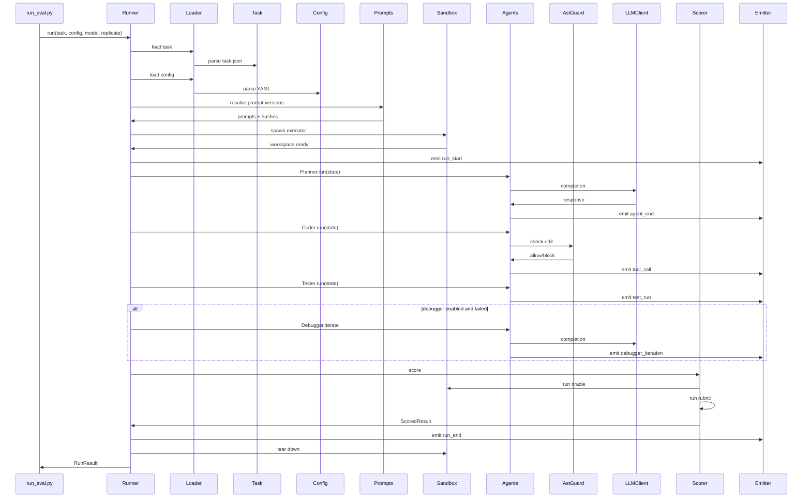

# Flow — OS Devin Evaluation Harness

This document traces the end-to-end execution path of a run, from CLI invocation to a scored result on disk. It is the "how" companion to [`ARCHITECTURE.md`](ARCHITECTURE.md) (the "what").

---

## Overview

A run is a single execution of the agent pipeline against one task, with one config, on one model, replicated `n` times. The flow has four phases:

1. **Setup** — load task, config, and prompts; resolve model parameters; spawn isolation
2. **Pipeline** — drive the agent loop (Planner → Coder → Tester → Debugger → Reviewer)
3. **Scoring** — run oracle, run rubric, compute metrics
4. **Teardown** — finalize trace, tear down isolation, write scored result

The matrix runner repeats this for every cell of the matrix.

---

## Phase 1: Setup

### 1.1 CLI invocation

```bash
python scripts/run_eval.py \
  --task evals/tasks/008_fix_off_by_one_pagination \
  --config configs/plus_debug.yaml \
  --model sonnet-4.5 \
  --replicate 1
```

### 1.2 Argument parsing

The CLI parses args into a `RunSpec`:

```python
@dataclass
class RunSpec:
    task_id: str
    config_id: str
    model_id: str
    replicate: int
    output_dir: Path = Path("results/raw")
```

### 1.3 Task loading

```python
task = evals.loader.load_task(run_spec.task_id)
# - Reads evals/tasks/<id>/task.json
# - Validates schema
# - Returns Task dataclass
```

Validation rules:
- `task.json` has all required fields, including `ground_truth_failure_class`
- `repo_before/` exists and is a valid Python repo
- `oracle.py` (or `oracle` command in JSON) is runnable
- All rubric check names are in `RUBRIC_REGISTRY`

### 1.4 Config loading

```python
config = harness.config.load_config(run_spec.config_id)
# - Reads configs/<name>.yaml
# - Validates schema
# - Returns Config dataclass
```

### 1.5 Prompt resolution

For each agent, resolve the version:

```python
prompts = {}
prompt_hashes = {}
for agent in ["planner", "coder", "tester", "debugger", "reviewer"]:
    version = config.agents[agent].prompt_version or \
              harness.llm.prompts.resolve_version(agent)
    prompts[agent] = harness.llm.prompts.load_prompt(agent, version)
    prompt_hashes[agent] = harness.llm.prompts.hash_prompt(agent, version)
```

If a version is missing or the file doesn't exist, abort with a clear error.

### 1.6 Model parameter resolution

```python
model_params = {
    "temperature": 0.0,
    "top_p": 1.0,
    "max_tokens": 4096,
    "seed": 42,
    # Provider-specific keys from config
}
```

The runner aborts if `temperature != 0.0` (warns) or if the model is unknown.

### 1.7 Isolation

```python
executor = harness.sandbox.factory.make_executor(
    level=config.isolation.level,
    limits=config.isolation.resource_limits,
)
executor.__enter__()
```

The executor creates a temp directory (or Docker container) and copies `repo_before/` into it. The worker's CWD is the workspace.

### 1.8 Run header emission

```python
trace_jsonl = open(results/raw/<run_id>.jsonl, "a")
emitter = EventEmitter(trace_jsonl)
emitter.emit({
    "event": "run_start",
    "run_id": run_id,
    "task_id": task.id,
    "config_id": config.name,
    "model_id": run_spec.model_id,
    "replicate": run_spec.replicate,
    "model_params": model_params,
    "prompt_versions": {a: v for a, v in prompt_versions.items()},
    "prompt_hashes": prompt_hashes,
    "config_hash": hash_config(config),
    "task_hash": hash_task(task),
    "started_at": now(),
})
```

---

## Phase 2: Pipeline

### 2.1 State initialization

```python
state = {
    "task": task,
    "config": config,
    "workspace": executor.workdir,
    "scratchpad": [],
    "tool_history": [],
    "tests_run": [],
}
```

### 2.2 Planner

```python
emitter.emit({"event": "agent_start", "agent": "planner"})
plan = harness.agents.planner.run(state, prompts["planner"], model_params)
emitter.emit({"event": "agent_end", "agent": "planner", "outcome": "plan_generated"})
state["plan"] = plan
```

Planner outputs:
- `subtasks: list[Subtask]` — DAG of subtasks
- `target_files: list[str]` — files expected to be modified
- `approach: str` — high-level strategy

### 2.3 Coder

```python
emitter.emit({"event": "agent_start", "agent": "coder"})
while not state["plan"].all_subtasks_done():
    subtask = state["plan"].next_pending_subtask()
    edit = harness.agents.coder.run(state, subtask, prompts["coder"], model_params)
    # edit is a list of tool calls
    for tool_call in edit:
        apply_tool_call(state, tool_call, ast_guard)
        emit_tool_event(tool_call)
emitter.emit({"event": "agent_end", "agent": "coder", "outcome": "edits_applied"})
```

Coder tool calls (all routed through AST guard if enabled):
- `read_file(path)` — read
- `write_file(path, content)` — write (AST-checked)
- `edit_file(path, find, replace)` — surgical edit (AST-checked)
- `list_files(path)` — list
- `search_text(pattern, path)` — grep
- `run_command(cmd, timeout)` — shell

AST guard intercepts `write_file` and `edit_file`:

```python
def apply_tool_call(state, tool_call, ast_guard):
    if tool_call.tool in ("write_file", "edit_file"):
        if state["config"].guards.ast_pre_edit:
            result = ast_guard.check(
                path=tool_call.args["path"],
                content=tool_call.args.get("content") or tool_call.args["replace"],
                repo=state["workspace"],
            )
            if not result.allow:
                state["scratchpad"].append({"ast_blocked": result})
                emit({"event": "ast_block", "reason": result.reason})
                return  # Skip the edit
    executor.run_tool(tool_call)
    emit({"event": "tool_call", ...})
```

### 2.4 Tester

```python
emitter.emit({"event": "agent_start", "agent": "tester"})
result = harness.agents.tester.run(state, prompts["tester"])
emitter.emit({"event": "test_run", "pass": result.passed, "fail": result.failed})
emitter.emit({"event": "agent_end", "agent": "tester", "outcome": "pass" if result.passed else "fail"})
state["test_result"] = result
```

Tester runs `oracle.command` in the workspace, parses output, returns:

```python
@dataclass
class TestResult:
    passed: int
    failed: int
    errors: list[TestError]
    duration_s: float
    agent_classified_failure: str | None  # FailureClass value
```

### 2.5 Debugger (conditional)

Only runs if `config.agents.debugger.enabled = true`.

```python
if config.agents.debugger.enabled and not state["test_result"].passed:
    for attempt in range(config.agents.debugger.max_attempts):
        emitter.emit({"event": "debugger_iteration", "n": attempt + 1})

        # Debugger classifies the failure
        classification = harness.agents.debugger.classify(
            state["test_result"], prompts["debugger"]
        )
        state["debugger_classifications"].append(classification)

        # Debugger proposes a fix
        fix = harness.agents.debugger.propose_fix(
            state, classification, prompts["debugger"]
        )
        for tool_call in fix:
            apply_tool_call(state, tool_call, ast_guard)

        # Re-run tests
        result = harness.agents.tester.run(state, prompts["tester"])
        emit({"event": "test_run", ...})
        state["test_result"] = result

        if result.passed:
            break

    emitter.emit({"event": "agent_end", "agent": "debugger",
                  "outcome": "tests_pass" if result.passed else "max_attempts_exceeded"})
```

Bounded by `max_attempts` (default 5). If exhausted, the run ends with `success = false`.

### 2.6 Reviewer

```python
emitter.emit({"event": "agent_start", "agent": "reviewer"})
summary = harness.agents.reviewer.run(state, prompts["reviewer"])
emitter.emit({"event": "agent_end", "agent": "reviewer", "outcome": "summary_generated"})
state["summary"] = summary
```

Reviewer produces a PR-style summary. Output is captured but not used in scoring (v1; future v2 might use it for human review).

### 2.7 Pipeline end

```python
emitter.emit({"event": "pipeline_end", "ts": now()})
```

---

## Phase 3: Scoring

### 3.1 Oracle run (re-verification)

```python
oracle_result = run_oracle(task, executor.workdir)
# - Runs the oracle command in the workspace
# - Returns pass/fail
```

Re-running the oracle independently of the agent's Tester is important: the agent's Tester may have skipped tests, hidden failures, or modified the workspace. The scorer's oracle is the source of truth.

### 3.2 Rubric execution

```python
rubric_results = []
for check_spec in task.rubric:
    check_cls = RUBRIC_REGISTRY[check_spec.name]
    check = check_cls()
    result = check.check(repo_before, executor.workdir, task)
    rubric_results.append(result)
```

Each check is a deterministic function. See [`docs/EVAL_METHODOLOGY.md`](EVAL_METHODOLOGY.md).

### 3.3 Failure class comparison

```python
if state["test_result"] and state["test_result"].failed > 0:
    agent_class = state["test_result"].agent_classified_failure
    gt_class = task.ground_truth_failure_class
    fc_match = harness.failure_class.classify_match(agent_class, gt_class)
else:
    fc_match = "n/a"
```

### 3.4 Success computation

```python
success = (
    oracle_result.passed
    and all(r.passed for r in rubric_results)
)
```

### 3.5 Metrics computation

```python
metrics = {
    "tool_calls_total": len(state["tool_history"]),
    "tool_calls_redundant": count_redundant(state["tool_history"]),
    "retries": len(state["debugger_classifications"]),
    "in_scope_edits": count_edits(state["tool_history"], task.expected_files),
    "out_of_scope_edits": count_edits(state["tool_history"], task.forbidden_files),
    "ast_blocks": len(state["ast_blocks"]),
    "latency_s": (now() - started_at).total_seconds(),
    "tokens_input": state["tokens_input_total"],
    "tokens_output": state["tokens_output_total"],
    "cost_usd": state["cost_usd_total"],
}
```

### 3.6 Scored result emission

```python
scored_result = {
    "run_id": run_id,
    "task_id": task.id,
    "config_id": config.name,
    "model_id": run_spec.model_id,
    "replicate": run_spec.replicate,
    "success": success,
    "metrics": metrics,
    "failure_class_agent": state["test_result"].agent_classified_failure,
    "failure_class_ground_truth": task.ground_truth_failure_class,
    "failure_class_match": fc_match,
    "rubric_results": [r.to_dict() for r in rubric_results],
    "oracle_output": oracle_result.stdout_tail,
}

emit({"event": "run_end", "success": success, "ts": now()})
write_scored_result(scored_result, results/raw/<run_id>.json)
```

---

## Phase 4: Teardown

### 4.1 Isolation tear-down

```python
executor.__exit__()
# LocalSafe: shutil.rmtree(workdir)
# Docker: container.stop() + container.remove()
```

**Always runs**, even on exception. The `try/finally` block in the runner guarantees this.

### 4.2 Trace close

```python
trace_jsonl.close()
```

### 4.3 Return

```python
return RunResult(
    run_id=run_id,
    trace_path=trace_jsonl_path,
    scored_result=scored_result,
)
```

---

## Error paths

### E1. LLM call fails

Provider returns an error or times out. The runner retries with exponential backoff (3 attempts, 1s/2s/4s). If all fail, the run is marked `success = false` with `failure_class_agent = "other"` and the trace is preserved.

### E2. Tool call fails

`run_command` exits non-zero. The agent handles this; the agent sees the stderr. No special scorer logic — the failure surfaces in the test result.

### E3. AST guard blocks

The agent's proposed edit is rejected. The agent sees the rejection reason and can revise. The trace records an `ast_block` event. The scorer records `ast_blocks` count.

### E4. Debugger exhausts retries

All `max_attempts` iterations fail. The run ends with `success = false`. The metric `retries` shows the number of attempts. The failure classifications are preserved for analyzer.

### E5. Test timeout

A test run exceeds `time_limit_seconds`. The executor kills the subprocess. The test result is `failed` with `failure_class_agent = "timeout"`. The scored result preserves the partial state.

### E6. Token budget exceeded

The accumulated token count exceeds `task.token_budget`. The runner aborts the pipeline (the agent mid-flight is killed). The run is marked `success = false` with `failure_class_agent = "other"`.

### E7. Isolation breach

The Docker executor detects that the agent tried to access the host filesystem or network. The container is killed. The run is marked `success = false` with `failure_class_agent = "out_of_scope_edit"` (or similar). The trace captures the breach attempt.

---

## Per-config flow differences

The flow above is the **full** path. Configs disable parts:

| Config | Disables |
|---|---|
| `baseline` | Debugger, AST guard |
| `+debug` | AST guard |
| `+ast` | Debugger |
| `full` | (nothing) |

Disabled components are not invoked. Their would-be events are absent from the trace. The metrics are computed identically (e.g., `retries` is 0 for configs without a debugger).

---

## Matrix flow

For the full matrix:

```
matrix_spec = {
  "configs": ["baseline", "plus_debug", "plus_ast", "full"],
  "models": ["sonnet-4.5", "gpt-5", "qwen-3-coder-30b"],
  "tasks": list(task_loader.iter_all()),
  "replicates": 3,
}

# 4 × 3 × 18 × 3 = 648 runs
all_results = []
for config, model, task, rep in product(...):
    result = runner.run(task, config, model, rep)
    all_results.append(result)

# Aggregate
summary = aggregate(all_results)
# summary["baseline"]["sonnet-4.5"] = {"success_rate": 0.45, "ci": (0.39, 0.51), ...}

# Render
report = render_markdown(summary)
report.save("results/reports/comparison.md")
```

Concurrency control: `scripts/run_matrix.py` uses a `concurrent.futures.ProcessPoolExecutor` with a configurable `max_workers` (default 4). Each run is independent; no shared state.

---

## Sequence diagram



---

## Cross-references

- [`ARCHITECTURE.md`](ARCHITECTURE.md) — component model
- [`EVAL_METHODOLOGY.md`](EVAL_METHODOLOGY.md) — the four metric families and the scoring rules
- [`TASK_DESIGN.md`](TASK_DESIGN.md) — the task schema
- [`CONFIG_ABLATION.md`](CONFIG_ABLATION.md) — the 4 configs and what each isolates
- [`SAFETY.md`](SAFETY.md) — isolation, resource limits, error containment
- [`PROJECT_SPEC.md`](../PROJECT_SPEC.md) — non-functional requirements this flow satisfies
